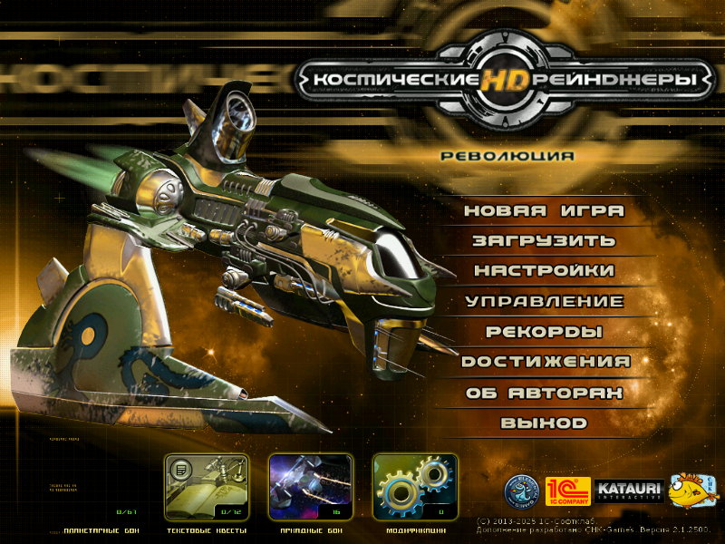
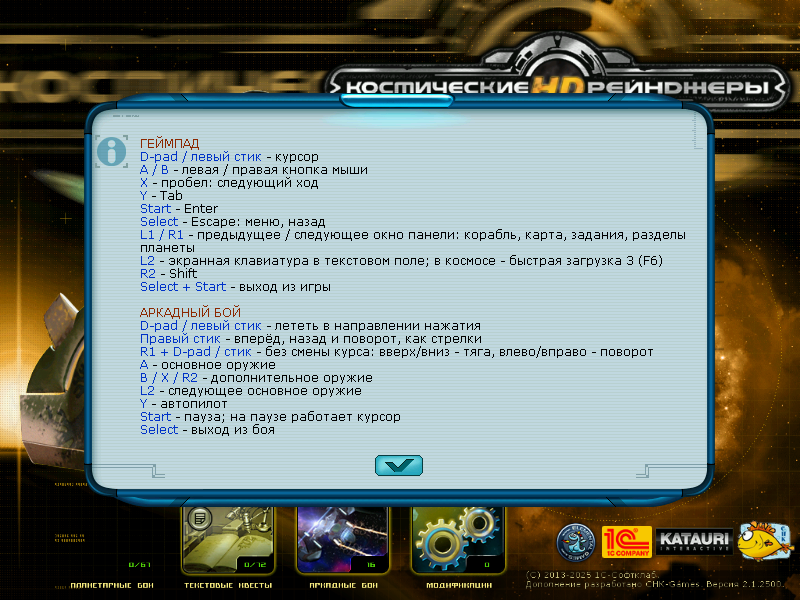
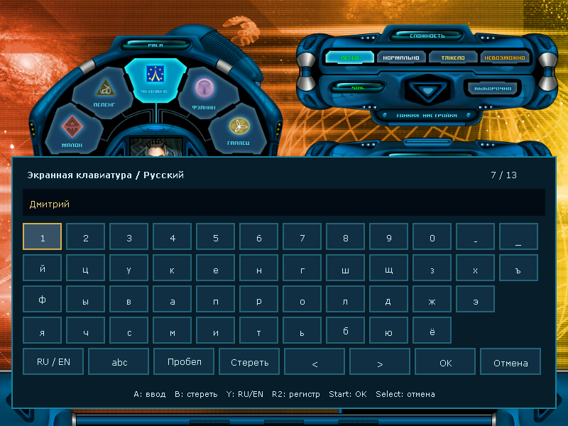
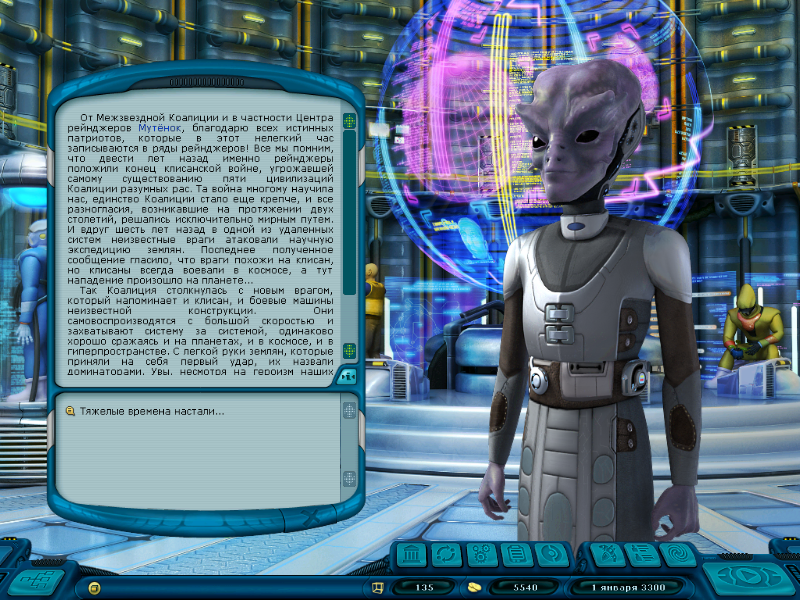
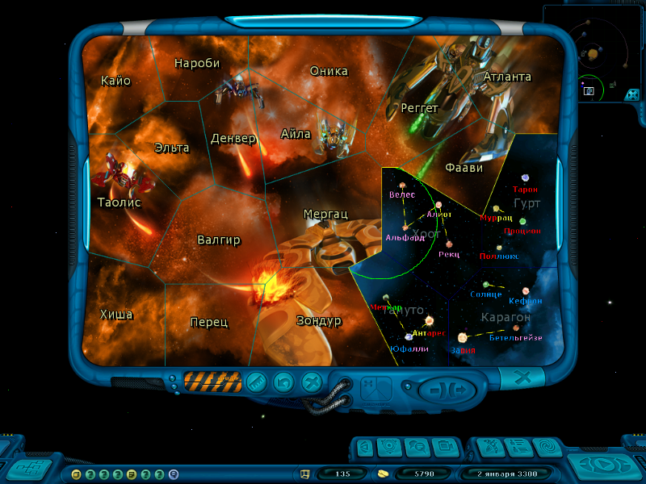
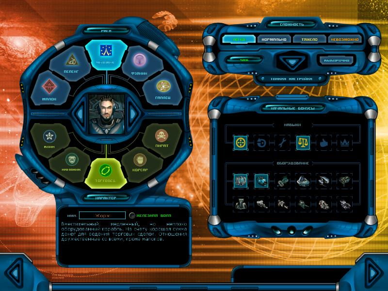
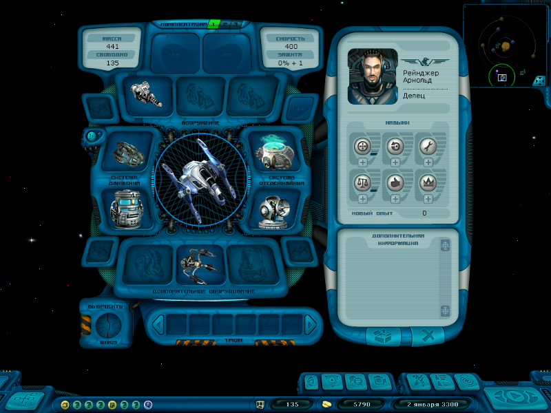

[Русская версия](README.md)

# Space Rangers HD on Anbernic and TrimUI

An unofficial Free Pascal port of **Space Rangers HD: A War Apart** for Linux
handhelds: gamepad controls, a Russian/English on-screen keyboard and a UI
that fits 800×600.

**[⬇ Download the latest release](https://github.com/YOZH3G/SRHD_FPC_Anbernic/releases/latest)**
· [Installation and troubleshooting](platform/linux/ANBERNIC.md)
· [Build from source](BUILDING.md)

> [!IMPORTANT]
> Supply game assets from your own **licensed copy**; downloads contain the port only.

> [!NOTE]
> Status: **experimental**. Testers have run builds on the RG40XX H and TrimUI,
> but there is no systematic check of every model, its GPU, sound and controls yet.
> Device reports are welcome in [Issues](https://github.com/YOZH3G/SRHD_FPC_Anbernic/issues).

## Contents

- [Choose a package](#choose-a-package)
- [Install](#install)
- [Controls](#controls)
- [Screenshots](#screenshots)
- [Resolution and renderer](#resolution-and-renderer)
- [Performance](#performance)
- [What is verified](#what-is-verified)
- [Development and attribution](#development-and-attribution)

## Choose a package

Choose your installed firmware first, then check the model:

| Firmware | Models | Package | Architecture |
| --- | --- | --- | --- |
| muOS | RG35XX Plus/H/SP/2024, RG28XX, RG34XX SP, RG40XX H/V | `SpaceRangersHD-H700-muOS.zip` | ARMHF and AArch64 |
| KNULLI | the same H700 models | `SpaceRangersHD-H700-KNULLI.zip` | AArch64 |
| Anbernic stock or Stock OS Mod (64-bit) | RG28XX, RG34XX, RG34XX SP, RG35XX Plus/2024/H/SP/Pro, RG40XX H/V, RG CubeXX, RG SP | `SpaceRangersHD-H700-StockOS.zip` | AArch64 |
| ArkOS | RG353V/VS/M, RG351P/M/V/MP, RG503 | `SpaceRangersHD-Rockchip-ArkOS.zip` | AArch64 |
| AmberELEC | RG351P/M/V/MP, RG552 | `SpaceRangersHD-Rockchip-AmberELEC.zip` | AArch64 |
| ROCKNIX | RG353P/PS/V/VS/M, RG552, RG503 | `SpaceRangersHD-Rockchip-ROCKNIX.zip` | AArch64 |
| TrimUI stock or CrossMix-OS | TrimUI Smart Pro, Smart Pro S, Brick, Brick Pro | `SpaceRangersHD-TrimUI.zip` | AArch64 |

RG351P/M on ArkOS require a compatible community release. The original
RG35XX 2022/2023, 32-bit stock firmware and Android are not covered by these packages.
Package checksums are in the release's `SHA256SUMS`.

## Install

You need `INSTALL*.TXT`, `CFG.TXT`, `CFG/` and `DATA/` from your installed game.
Copy them into the port's `game/` folder; `INSTALL.TXT` must be directly inside it.

<b>muOS, KNULLI, ArkOS, AmberELEC, ROCKNIX — with PortMaster</b>

1. Install current **PortMaster**. The firmware must provide **SDL2 ≥ 2.26.0**
   and **glibc ≥ 2.29**.
2. Extract the package into the Ports directory: muOS uses
   `/mnt/mmc/ROMS/Ports` or `/mnt/sdcard/ROMS/Ports`; KNULLI uses
   `/userdata/roms/ports`; ArkOS/AmberELEC/ROCKNIX usually use `/roms/ports`.
   See the [full instructions](platform/linux/ANBERNIC.md) for alternate paths.
3. Keep `Space Rangers HD.sh` beside `spacerangershd/`. The game assets go into
   `spacerangershd/game/`.
4. Refresh the game list and launch **Space Rangers HD** from Ports.

<b>Anbernic stock firmware or Stock OS Mod</b>

PortMaster is not needed. Extract `SpaceRangersHD-H700-StockOS.zip` into
`Roms/APPS` on the games card, copy the game assets into
`Roms/APPS/spacerangershd/game/` and launch **Space Rangers HD** from the Apps
section. See the [full instructions](platform/linux/ANBERNIC.md) (Russian).

<b>TrimUI: stock firmware or CrossMix-OS</b>

PortMaster is not needed. Extract `SpaceRangersHD-TrimUI.zip` into the SD card
root, copy the game assets into `Apps/SpaceRangersHD/spacerangershd/game/` and
launch **Space Rangers HD** from the Apps section.

Settings and saves live in `spacerangershd/profile/`; the launcher log is
`spacerangershd/log.txt`. Back up `game/` and `profile/` before updating and do
not mix libraries from different port versions. SDL and display/audio drivers
come from the firmware; the package includes the other runtime libraries.

## Controls

The main menu's **Controls** entry shows every button, arcade combat included.

| Button | Action |
| --- | --- |
| D-pad / left stick | mouse cursor |
| A / B | left / right click |
| X / Y | Space (next turn) / Tab |
| Start / Select | Enter / Escape: menu, back |
| L1 / R1 | previous / next window of the bottom-right panel: ship, map, quests, and on a planet its sections |
| L2 | on-screen keyboard in a text field; quick load 3 (F6) in space |
| R2 | Shift |
| Select + Start | quit the game |

On the Anbernic stock firmware the volume buttons change the game's volume and the
power button puts the handheld to sleep: the firmware handles them only in its own menu.

<b>Arcade combat</b>

During arcade combat the buttons fly the ship and the cursor stays put:

| Button | Action |
| --- | --- |
| D-pad / left stick | fly in that direction |
| Right stick | thrust/reverse and turn, like the arrow keys |
| R1 + D-pad / left stick | the same without changing course: up/down thrust forward/back, left/right turn |
| A | primary weapons |
| B / X / R2 | secondary weapons |
| L2 | next primary weapon |
| Y | autopilot on/off |
| Start | pause; the cursor works again while paused |
| Select | leave the battle |

<b>RU/EN on-screen keyboard</b>

Click a text field with **A** to open the keyboard; **L2** opens it for the
focused field. While it is open:

- **Y:** Russian/English; **R2:** lower/upper case, including ё/Ё.
- **A:** press a key; **B:** delete the character before the caret.
- On-screen Space, `<` and `>` insert a space and move the caret.
- **Start** or **OK** apply; **Select** or **Cancel** discard edits.

The keyboard respects each field's length and character limits. The port's
launchers turn it on; manual launches use `--on-screen-keyboard`.

## Screenshots

| The Controls entry | On-screen keyboard |
| --- | --- |
|  |  |
| **Ranger center** | **Galaxy map** |
|  |  |
| **Character setup** | **Ship** |
|  |  |

The 800×600 frames were captured with licensed game assets from the port's
x86_64 build using the same settings as on a handheld: automatic UI choice and
SDL drawing. [All screenshots](docs/screenshots/README.md), including the
earlier sets from the ARM builds under QEMU.

## Resolution and renderer

The minimum internal resolution is **800×600**: set `VideoMode=800,600` in
`profile/CFG.TXT` and keep Mobile UI enabled. Menus, station, shops, equipment,
galaxy map, journal, save/load and the keyboard fit the frame; the space HUD
scales separately from the world. Lower values are replaced with 800×600.
Fullscreen scales the frame to the panel while preserving aspect ratio: a
640×480 panel shows the whole image scaled down, and on the RG34XX SP's
720×480 panel the 4:3 image fills 640×480 with side bars.

Linux defaults to the hardware-accelerated `--renderer=sdl`. If acceleration
is unavailable, the game falls back to software drawing automatically;
`--renderer=software` forces it. The selected driver and fallback reason are in
`spacerangershd/profile/rangers-fpc.log`.

## Performance

The SDL renderer is optimized without changing resolution or image quality:
buffer reuse, texture-state caching, batched points, direct rectangle fills,
cached space-object textures and a frame limiter that sleeps until the frame is
due. Pixel identity with the original drawing path is checked on software,
OpenGL and GLES2.

All measurements were taken under QEMU and on x86_64, not on handhelds.
[Method, results and limitations](docs/performance/README.md) (Russian).

## What is verified

Every release is rebuilt from source. The final binaries for both architectures
pass the main menu, a new game, station, hangar, takeoff and 20 seconds in space
under QEMU; glibc imports no newer than 2.29 and launcher scenarios are checked
too. The stock-firmware package also runs that scenario on the system libraries
of the stock firmware images for all 11 H700 models, and the TrimUI package on
the Smart Pro S firmware libraries and the Smart Pro, Brick and Brick Pro root
filesystems. Release notes list the SHA256 of the verified binaries. RU/EN input and
the 800×600 screens were verified by dedicated scenarios when introduced.

Not systematically verified: behavior on each model, their GPUs and display
rotation, sound and controls, extended play.

## Development and attribution

This fork is based on the port author's
[reference `main`](https://github.com/pakompom/SpaceRangersHD_FPC/tree/main);
[UPSTREAM.md](platform/linux/UPSTREAM.md) records the revision and migration.
The upstream port was developed with LLMs through Codex.

- `source/`: Pascal game code; `platform/`: compatibility and SDL runtime;
  `native/`: native libraries; `tools/`: build, packaging and tests.
- `vendor/fpc/` and `vendor/okgf/`: pinned submodules —
  `git submodule update --init --recursive`.
- [Building](BUILDING.md), [development notes](DEVELOPING.md),
  [behavior changes](CHANGES.md).
- [License for custom additions](LICENSE) and [rights and attribution](NOTICE.md).

Unofficial; not affiliated with the game's developers or publisher.
