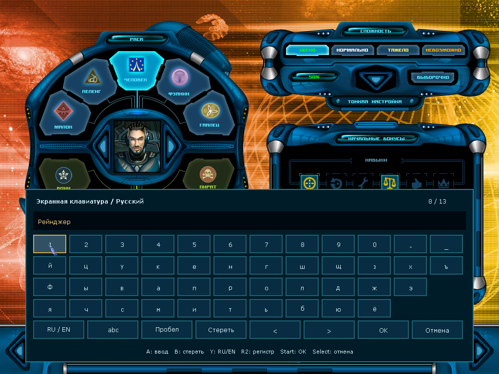
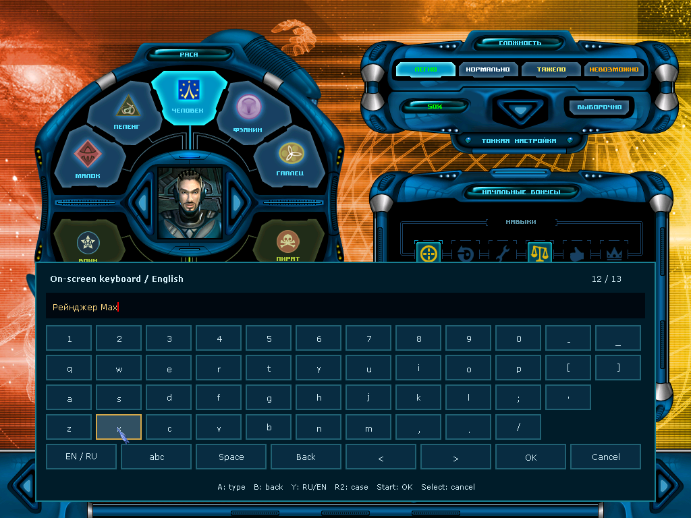
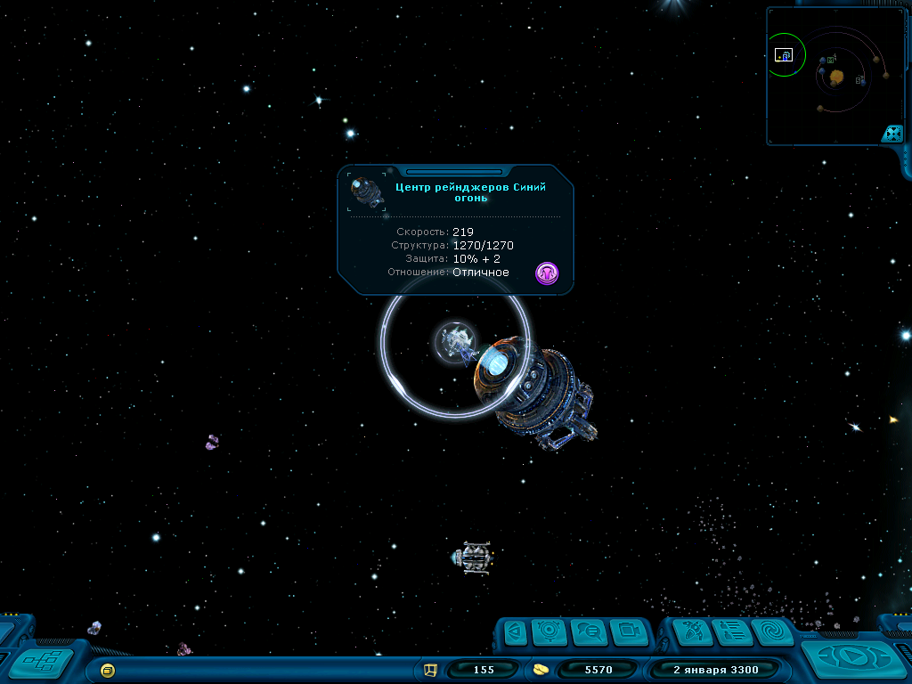
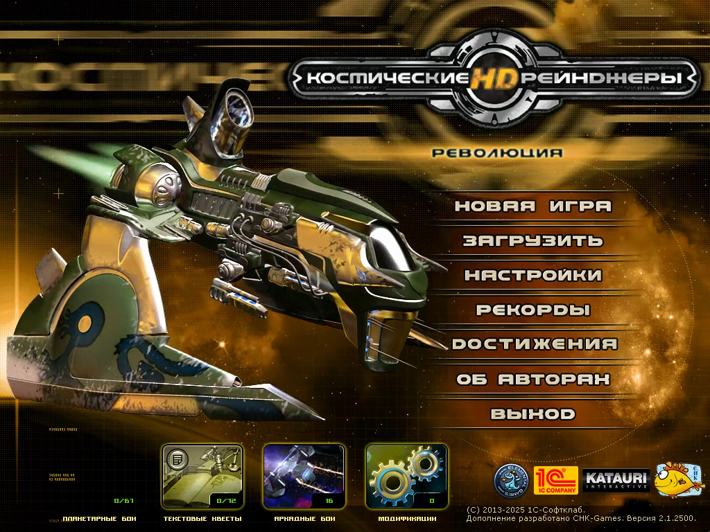

[English version](README.md)

# Space Rangers HD — Anbernic Linux / FPC Port

Неофициальный Free Pascal-порт **«Космических рейнджеров HD: Революция»**
с экспериментальными сборками для Anbernic Linux и экранной клавиатурой RU/EN.
Для запуска нужны ресурсы вашей лицензионной копии игры. В архивы входит только порт.

[Скачать сборки](https://github.com/YOZH3G/SRHD_FPC_Anbernic/releases/tag/anbernic-performance-v2-2026.10.11)
· [Подробная установка и диагностика](platform/linux/ANBERNIC.md)
· [Сборка из исходников](BUILDING.md)

## Выбор сборки

Сначала выберите установленную прошивку, затем проверьте модель:

- **muOS:** RG35XX Plus/H/SP/2024, RG28XX, RG40XX H/V — пакет H700 с ARMHF и AArch64.
- **KNULLI:** те же модели с H700 — AArch64.
- **ArkOS:** RG353V/VS/M, RG351P/M/V/MP, RG503 — AArch64. Для RG351P/M нужен подходящий выпуск сообщества.
- **AmberELEC:** RG351P/M/V/MP и RG552 — AArch64.
- **ROCKNIX:** RG353P/PS/V/VS/M, RG552 и RG503 — AArch64.

Это целевые модели для проверки. Запуск на физических приставках пока не проверен.
Оригинальный RG35XX 2022/2023 и Android этими Linux-пакетами не охвачены.

## Установка

1. Установите актуальный **PortMaster**. В прошивке должны быть
   **SDL2 ≥ 2.26.0** и **glibc ≥ 2.29**.
2. Распакуйте нужный архив в каталог Ports: для muOS это
   `/mnt/mmc/ROMS/Ports` или `/mnt/sdcard/ROMS/Ports`, для KNULLI —
   `/userdata/roms/ports`, для ArkOS/AmberELEC/ROCKNIX обычно — `/roms/ports`.
   Другие расположения приведены в [подробной инструкции](platform/linux/ANBERNIC.md).
3. Файл `Space Rangers HD.sh` должен лежать рядом с папкой `spacerangershd/`.
   Скопируйте `INSTALL*.TXT`, `CFG.TXT`, папки `CFG/` и `DATA/` из установленной
   игры в `spacerangershd/game/`. Файл `INSTALL.TXT` должен находиться
   непосредственно в этой папке.
4. Обновите список игр и запустите **Space Rangers HD** из раздела Ports.

Настройки и сохранения находятся в `spacerangershd/profile/`, журнал запуска —
в `spacerangershd/log.txt`. Перед обновлением сохраните папки `game/` и `profile/`.
SDL и драйверы дисплея и звука используются из прошивки; остальные библиотеки
включены в пакет. Используйте библиотеки из одной версии порта.

## Управление и клавиатура RU/EN

Крестовина или левый стик двигают курсор; **A/B** — левая/правая кнопка мыши.
**Start/R1** — Enter, **Select** — Escape, **L1** — медленный курсор,
**X** — пробел, **Y** — Tab. Стики не обязательны.

Нажмите **A** на текстовом поле, чтобы открыть клавиатуру. **L2** открывает её
для активного поля. Пока клавиатура открыта:

- **Y** переключает русский и английский языки; **R2** — регистр, включая ё/Ё.
- **A** нажимает экранную клавишу; **B** удаляет символ перед кареткой.
- «Пробел» вставляет пробел, кнопки `<` и `>` перемещают каретку.
- **Start/R1** или **OK** применяют текст; **Select** или «Отмена» отменяют ввод.

Клавиатура соблюдает ограничения длины и допустимых символов исходного поля.
В запуске PortMaster она включена по умолчанию; при ручном запуске используйте
`--on-screen-keyboard`.

## Рендерер и разрешение экрана

По умолчанию Linux запускается с `--renderer=sdl`. Если создать ускоренный
рендерер или начальный render target не удалось, автоматически включается
программный режим. Для принудительного запуска без ускорения передайте
`--renderer=software`. Выбранный SDL-драйвер и причина перехода записываются
в `spacerangershd/profile/########.log`.

Разрешение панели отличается от разрешения игрового интерфейса: полноэкранный
режим масштабирует игровой кадр с сохранением пропорций. Экран 640×480 сам
по себе не означает, что интерфейс игры отрисовывается в 640×480.

В текущем коде минимальное внутреннее разрешение сборок Anbernic — **800×600**.
Для его выбора укажите `VideoMode=800,600` в `profile/CFG.TXT`; отдельный
экспериментальный ключ не требуется. Значения ниже минимума заменяются на
800×600. Меню и создание персонажа вписываются в кадр, HUD масштабируется
отдельно от карты космоса. Автоматический выбор разрешения пока сохраняет
прежнее поведение. В этот же кадр вписаны настройки, диалоги станции,
магазины, оборудование корабля, карта галактики, журнал, сохранение и загрузка,
а также клавиатура RU/EN. [Скриншоты и результаты проверки 800×600](docs/screenshots/adapted-800x600/README.md).
[Переключение разрешения внутри игры](docs/screenshots/resolution-switch/README.md)
проверяет восстановление компоновки при переходах между 800×600 и 1024×768.
Оборудование корабля в космосе центрируется над HUD в обоих разрешениях;
[актуальные кадры](docs/screenshots/centered-1024/README.md).
[Планетные экраны](docs/screenshots/planet-layout/README.md) заполняют кадр 800×600,
а портрет лидера вписан справа от диалога.
Эти исправления включены в релиз `anbernic-ui-2026.10.11`. Для адаптации должен быть включён «Мобильный интерфейс».

Оптимизированный SDL-рендерер повторно использует буферы геометрии и хранилища
привязанных ресурсов. В тесте интерфейса 800×600 под QEMU/SDL software время
отрисовки сократилось на 28,6% для ARMHF и 16,4% для AArch64. Это не измерения
FPS приставок; [методика и результаты](docs/performance/README.md).

Во втором этапе добавлен кеш фильтрации и смешивания текстур. Относительно
предыдущего релиза время той же тестовой сцены сократилось ещё на 6,74% для
ARMHF и 2,77% для AArch64. На AArch64 различия малы и частично сопоставимы
с разбросом; прирост для всех сцен не подтверждён. [Полные замеры v2](docs/performance/state-cache-results.json).

## Скриншоты

Скриншоты и видео ниже относятся к предыдущему
[релизу клавиатуры на enhanced-ветке](https://github.com/YOZH3G/SRHD_FPC_Anbernic/releases/tag/anbernic-keyboard-2026.10.11).

Кадры получены из работающих ARMHF/AArch64 сборок через QEMU с ресурсами
лицензионной игры. Это проверка порта; работа дисплея конкретной приставки
или прошивки на этих снимках не проверяется.

Русская клавиатура, ARMHF:

Английская клавиатура, AArch64:

Космос после вылета, AArch64:

[Остальные скриншоты и описание проверок](docs/screenshots/README.md).

## Видео: от главного меню до космоса

[Посмотреть или скачать запись AArch64](docs/media/aarch64-menu-to-space.mp4).
В ролике показаны главное меню, создание персонажа, генерация галактики,
станция, ангар и первый вылет; затем — 20 секунд в космосе.
Запись сохраняет реальное время и звук игры, без монтажа и ускорения.

Использован Linux AArch64-бинарник из пакета для ArkOS, запущенный через QEMU
с SDL из SDK. Это не запуск прошивки ArkOS и не проверка физической RG353V.
[Описание записи](docs/media/README.md) содержит хеш бинарника и способ захвата.

## Что проверено

На обеих архитектурах проверены ввод RU/EN, регистр, редактирование кареткой,
лимит имени, подтверждение и отмена. После обновления исходников автора обе
сборки завершили 300 предварительных ходов новой галактики, открыли станцию
и ангар, вылетели в космос, а затем загрузили новое автосохранение и вылетели снова.
В релизе приложены отчёт проверки и контрольные суммы SHA256.

Физические приставки, поворот их дисплеев, звук и кнопки, а также длительное
прохождение пока не проверены. Сборки имеют **экспериментальный статус**.

## Разработка и авторство

Ветка `main` этого форка перенесена на актуальную
[ветку `main` автора](https://github.com/pakompom/SpaceRangersHD_FPC/tree/main).
Упаковка Anbernic и клавиатура RU/EN адаптированы к её платформенному слою SDL.
[Описание обновлений](platform/linux/UPSTREAM.md) содержит ревизию и сведения о переносе.
Исходный FPC-порт разрабатывался с помощью LLM через Codex.

- [Изменения поведения](CHANGES.md) и [инструкция по сборке](BUILDING.md).
- `source/` — Pascal-код игры; `platform/` — совместимость и SDL.
- `native/` — нативные библиотеки; `tools/` — сборка, упаковка и проверки.
- `vendor/okgf/` и `vendor/fpc/` — закреплённые подмодули. Для загрузки выполните
  `git submodule update --init --recursive`.
- [Лицензия собственных доработок](LICENSE) и [авторы и права](NOTICE.md).

Проект не связан с разработчиками или издателем игры.
