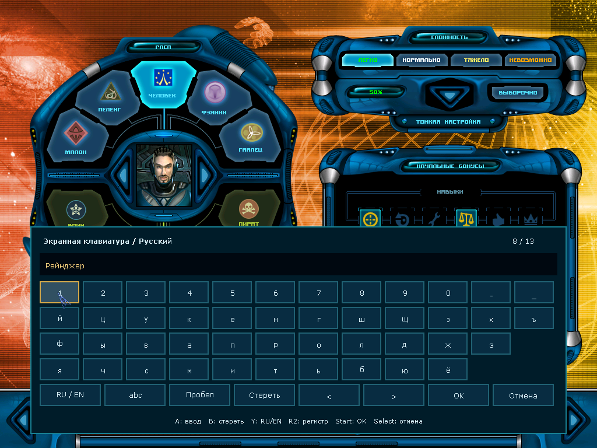
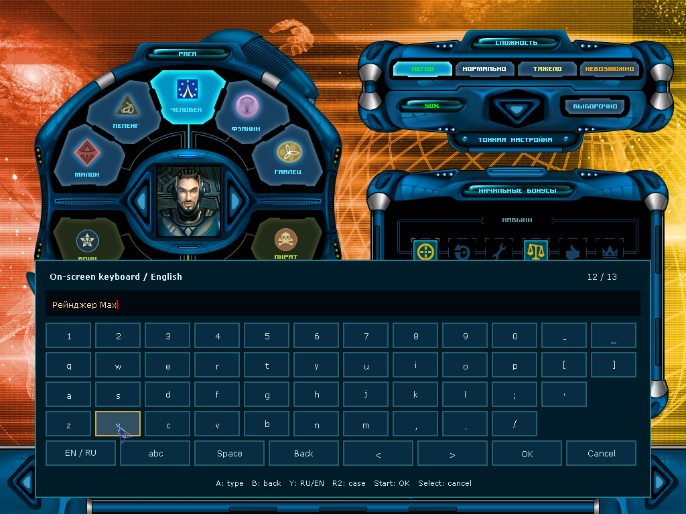
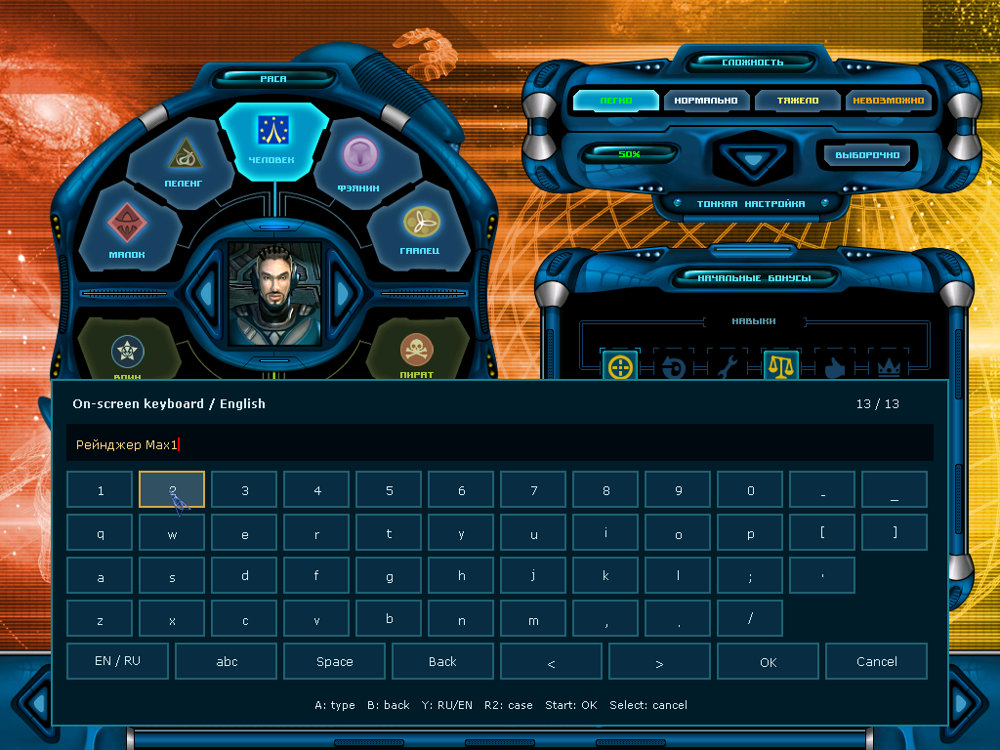
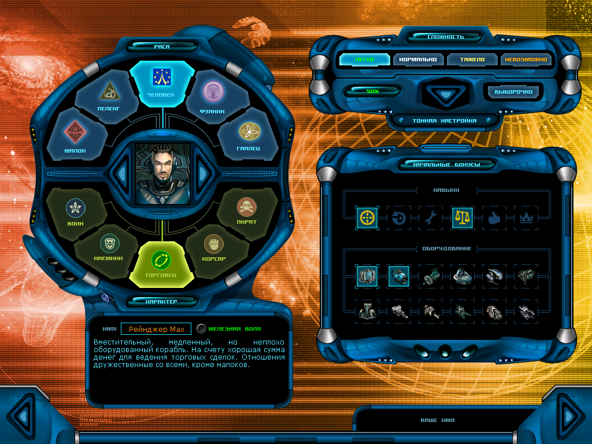
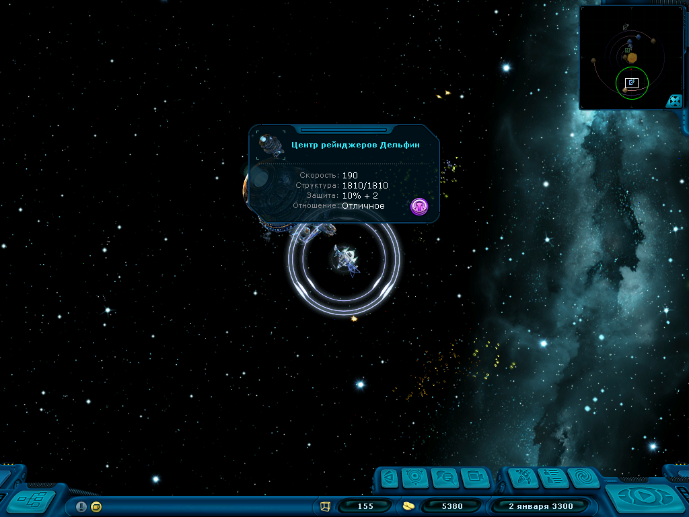

# Скриншоты / Screenshots

Все кадры сняты из настоящих ARMHF/AArch64-сборок под QEMU с SDL software
renderer и лицензионными ресурсами 2.1.2500, без изменения размера.
Физические приставки в съёмке не участвовали. Рядом с кадрами лежат JSON-отчёты
с кодами завершения и SHA256 проверенных бинарников.

All frames come from the real ARMHF/AArch64 builds running under QEMU with the
SDL software renderer and licensed game assets. No physical handheld was used.

[Русский README](../../README.md) · [English README](../../README_EN.md)

| Набор | Что показывает |
| --- | --- |
| [Интерфейс 800×600](adapted-800x600/README.md) | Меню, станция, магазины, карта, журнал, сохранение и клавиатура в минимальном режиме |
| [Оборудование по центру](centered-1024/README.md) | Окно корабля в 800×600 и 1024×768, переключение разрешения в игре |
| [Планетные экраны](planet-layout/README.md) | Фон города и правительства, лидер, исправление швов панели |
| Клавиатура RU/EN (ниже) | Первый релиз клавиатуры, `anbernic-keyboard-2026.10.11` |

## Клавиатура RU/EN

Эти кадры относятся к бинарникам раннего релиза `anbernic-keyboard-2026.10.11`.

| ARMHF | AArch64 |
| --- | --- |
|  |  |
|  |  |
|  |  |
|  |  |
|  |  |
|  |  |
