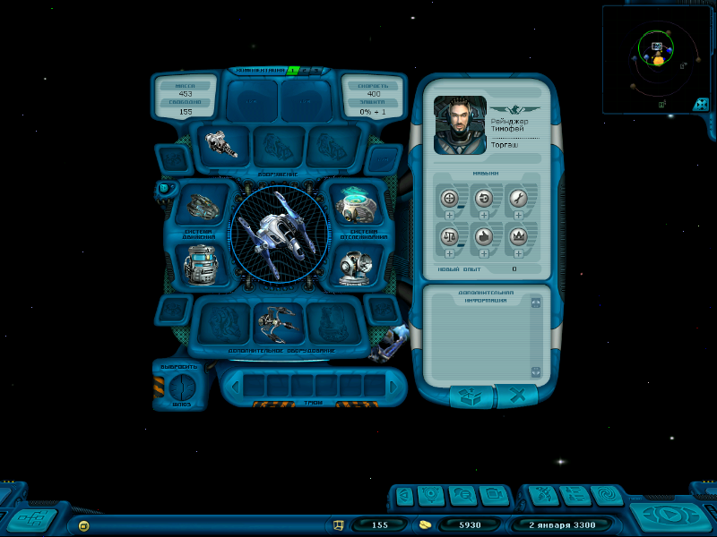
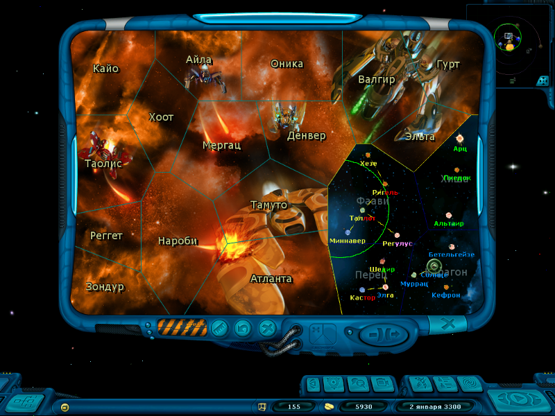
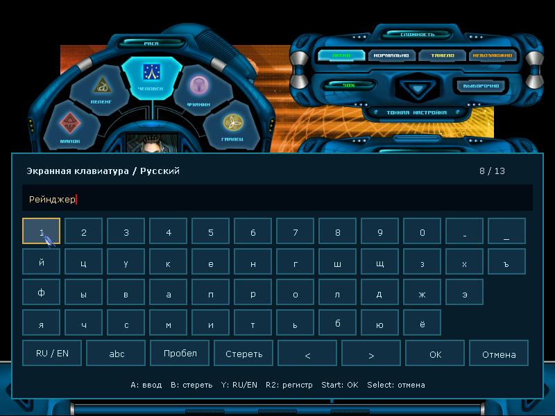
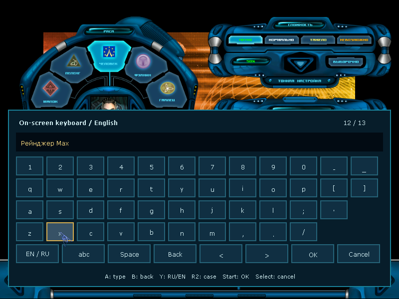

# Адаптация интерфейса к 800×600

Текущая рабочая версия Anbernic; опубликованный релиз пока не обновлён.
Выбор режима: `VideoMode=800,600` в `profile/CFG.TXT`. Отдельный
экспериментальный ключ не нужен. Значения ниже минимума заменяются на 800×600;
автоматический выбор разрешения сохраняет прежнее поведение.

Окна строятся в координатах 1024×768 и вписываются в настоящий кадр 800×600.
Масштаб применяется также к области нажатия. Карта космоса и курсор работают
в выбранном разрешении; клавиатура подбирает ширину непосредственно по экрану.
Фон модальных окон сохраняет размер кадра: исправлены двойной HUD и остатки
предыдущего окна при переходах. На дисплее 640×480 прошивка масштабирует кадр
800×600 с сохранением пропорций.

## Проверки

Файлы PNG получены из реальных кадров SDL без изменения размера.
Сценарий навигации ждёт не менее 1,5 секунды после открытия каждого окна:
ранние кадры оборудования показывали правую панель во время выдвижения,
когда она ещё частично находилась за основной панелью. Это промежуточное
состояние анимации, а не итоговое положение окна.
Лицензионные ресурсы и сохранения в эту папку не включены.
Навигация и клавиатура прошли на ARMHF и AArch64. Контрольный запуск меню
и создания персонажа на ARMHF в 1024×768 также прошёл.
Результаты запусков и SHA256 исполняемых файлов: [validation.json](validation.json).

Сценарий навигации открывает настройки, загрузку, ангар, диалог станции,
магазины оборудования и товаров, информацию станции, космос, оборудование
корабля, карту галактики, журнал, меню паузы и сохранение, затем возвращается
в космос. Выход из настроек выполняется нажатием на масштабированную кнопку
«Отмена», чтобы проверить соответствие изображения и области нажатия.
Окно сохранения проверяется открытием и закрытием; запись нового сохранения
этот сценарий не проверяет.

Проверка клавиатуры охватывает русский и английский ввод, перемещение курсора,
удаление, ограничение длины имени, подтверждение и отмену ввода.
Новая кампания на итоговой AArch64-сборке прошла отдельный сценарий: создание персонажа,
генерация галактики, ангар и вылет в космос.

Проверки выполняются под QEMU с SDL dummy и автоматическим переходом на
программный рендерер. Это не проверка физических GPU, кнопок, звука или FPS
Anbernic. Квесты, аркадные бои, планетарные роботы, моды и длительная игра
требуют отдельных проверок. Масштабирование сохраняет оформление оригинала;
читаемость мелкого текста на физическом экране ещё нужно оценить.

## Кадры ARMHF, 800×600

Оборудование корабля:

Карта галактики:

Русская клавиатура:

Английская клавиатура:

Дополнительные кадры: [настройки](settings.png), [станция](station.png),
[магазин оборудования](equipment.png), [торговля](goods.png),
[журнал](journal.png), [ангар](hangar.png), [космос](space.png),
[пауза](pause.png), [загрузка](load.png), [сохранение](save.png).

Новая кампания на итоговой AArch64-сборке: [создание персонажа](aarch64-new-campaign-character.png), [вылет в космос](aarch64-new-campaign-space.png).

Блок оборудования и правая панель в космосе центрируются вместе в области
над нижним HUD. Центрирование учитывает видимые границы рисунков после
выдвижения панели, а не скрытые края контейнера. При повторном открытии
смещение не накапливается. На станции сохраняется компоновка со складом
и сервисом: [кадр на станции](ship-docked-centered.png).
[Повторное открытие в космосе](ship-reopened-centered.png).

## Запуск текстового квеста

Из главного меню открыты текстовые квесты, затем нажата кнопка «Старт»
для выбранной «Тюрьмы». Исправлен конфликт общего масштабирования окна
с собственной адаптивной компоновкой квестов: мобильный интерфейс квеста
строится непосредственно в разрешении кадра.
Проверены открытие и первый экран; прохождение всего квеста не проверялось.

[Первый экран на ARMHF](prison-start-armhf.png), [отчёт ARMHF](prison-start-armhf.json).
[Первый экран на AArch64](prison-start-aarch64.png), [отчёт AArch64](prison-start-aarch64.json).
