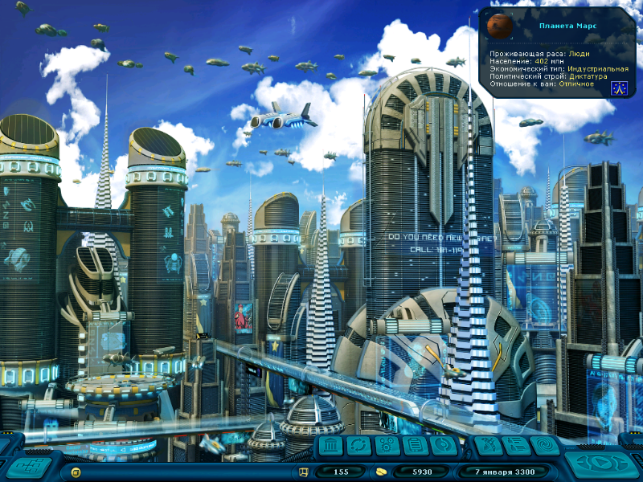
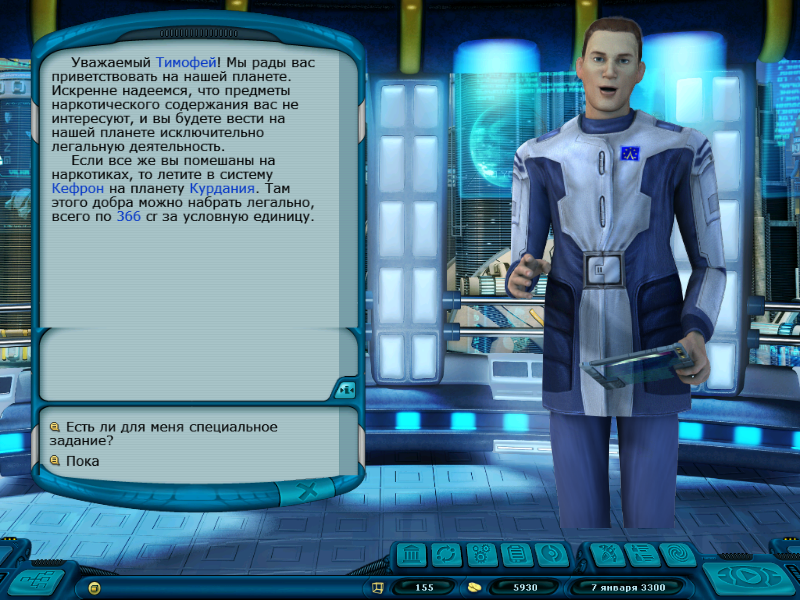

# Планетные экраны: фон и лидер

В 800×600 фон города и приёмной правительства готовится под логический
кадр 1024×768, затем уменьшается вместе с интерфейсом один раз. Раньше
фон, загруженный при открытии окна, сначала уменьшался до 800×600 и затем
повторно до 625×469, оставляя чёрные поля.

В мобильном интерфейсе 800×600 обе фазы анимации лидера вписываются
в общую область справа от диалога и над HUD. Пропорции сохраняются,
портрет не должен перескакивать при смене анимации или повторном открытии.
В 1024×768 сохраняется исходная компоновка лидера. Карточки сведений
и квеста планеты привязаны к правому краю логического окна.

Проверка использует сохранение после настоящей посадки на Марс. Из меню
загружается кампания, открывается правительство, затем ангар и оба магазина,
после чего правительство открывается повторно. Кадры сняты после открытия
окон из SDL, без изменения размера; ARMHF/AArch64 исполняются под QEMU
с SDL software/dummy. Это не проверка физической приставки. Проверена
человеческая планета; общий алгоритм применяется к остальным расам, но
каждая раса и пиратская разновидность отдельно в кампании не пройдены.

## Швы фоновой текстуры панели

На первоначальных кадрах 800×600 видны линии, через которые просвечивает
планета: SDL software пропускал дробные полосы повторяющейся текстуры.
Теперь общие границы прямоугольных фрагментов масштабируемого UI округляются
до физических пикселей. Фильтрация текстур, космос и промежуточные буферы
сохраняют прежний режим. Кадры ниже сняты после этого исправления.

`tools/tests/ui_tile_seams.pas` проверяет заполнение панели полосами шириной
в один логический пиксель при масштабе 800/1024. На ARMHF/AArch64 старый
путь оставляет 21 840 незаполненных пикселей; исправленный — 0. Проверка
при масштабе 1 также проходит. Дополнительно повторно пройдены планета,
правительство, ангар и магазины в обоих разрешениях на обеих архитектурах.

## ARMHF, 800×600

[Результат проверки](fixed/800x600/armhf-fresh-validation.json).

[Ангар](fixed/800x600/armhf-fresh-hangar.png),
[оборудование](fixed/800x600/armhf-fresh-equipment.png),
[товары](fixed/800x600/armhf-fresh-goods.png),
[повторное открытие](fixed/800x600/armhf-fresh-government-reopened.png).

## Сравнение с 1024×768

[Правительство ARMHF](fixed/1024x768/armhf-fresh-government.png),
[планета ARMHF](fixed/1024x768/armhf-fresh-planet.png),
[отчёт](fixed/1024x768/armhf-fresh-validation.json).

## AArch64

[Правительство 800×600](fixed/800x600/aarch64-fresh-government.png),
[планета 800×600](fixed/800x600/aarch64-fresh-planet.png),
[ангар](fixed/800x600/aarch64-fresh-hangar.png),
[оборудование](fixed/800x600/aarch64-fresh-equipment.png),
[товары](fixed/800x600/aarch64-fresh-goods.png),
[повторное открытие](fixed/800x600/aarch64-fresh-government-reopened.png),
[отчёт 800×600](fixed/800x600/aarch64-fresh-validation.json).

[Правительство 1024×768](fixed/1024x768/aarch64-fresh-government.png),
[планета 1024×768](fixed/1024x768/aarch64-fresh-planet.png),
[ангар](fixed/1024x768/aarch64-fresh-hangar.png),
[оборудование](fixed/1024x768/aarch64-fresh-equipment.png),
[товары](fixed/1024x768/aarch64-fresh-goods.png),
[повторное открытие](fixed/1024x768/aarch64-fresh-government-reopened.png),
[отчёт 1024×768](fixed/1024x768/aarch64-fresh-validation.json).

